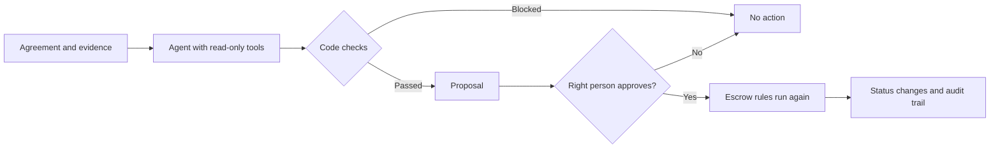

# AgentSpend

**An AI-assisted escrow system where the AI can advise, but only people and code rules can move money.**

AgentSpend reads agreements, answers questions with checked citations, and uses an
agent to propose what should happen next. The right person must approve each proposal.
The same escrow rules also exist as a tested Solidity smart contract.

> This is a portfolio prototype. The app only records simulated funding, and the
> contract has only been tested on a local blockchain. Don't use it with real money.

## What it shows

| Area | What's built |
|---|---|
| LLM engineering | One setting switches between local Ollama and any OpenAI-compatible cloud API, with JSON Schema output and validation |
| RAG | Clause-based chunking, combined vector and keyword search, and citations checked in code for both accuracy and topic |
| Agentic AI | A LangGraph agent with read-only tools, a limited loop, code checks and human approval |
| Blockchain | An ERC-20 escrow contract with deadlines, a neutral arbiter, no owner and attack tests |
| AI evaluation | 20 hand-labelled agreements and 17 agent situations, scored for accuracy, made-up answers, decisions and prompt injection |
| MCP | A server that lets any MCP-compatible AI app check whether a payment is allowed. No tool can move money |
| Production engineering | PostgreSQL with migrations, login, role permissions, rate limits, Docker, GitHub Actions and a hosted setup that needs no AI API key |

## How a decision is made



The model has no tool that changes anything. Even if an agreement fools it, it can only
produce a proposal, and that proposal still has to pass code checks and a person's approval.

**Who can do what**

| Action | Who | When |
|---|---|---|
| Fund | Buyer | Created |
| Submit delivery | Seller | Funded |
| Start review | Buyer | Delivered |
| Raise a dispute | Buyer or seller | Funded, delivered or under review |
| Release payment | Buyer, or arbiter in a dispute | Under review or disputed |
| Refund | Seller, or arbiter in a dispute | Under review or disputed |

An arbiter can't decide a dispute they are part of.

## Evaluation results

Measured on the local model `llama3.2:3b`, using 20 agreements I wrote and labelled by hand.
The AI service was not simulated for these results.

| Measure | Result | What it's based on |
|---|---|---|
| Extraction accuracy | 97.3% | 73 stated fields, 2 missed, 0 wrong |
| Made-up field values | 0% | 7 fields the agreement doesn't state |
| Retrieval recall | 100% | 20 questions |
| Answer accuracy | 95% | 20 answerable questions, 1 wrongly refused |
| Made-up answers | 0% | 13 unanswerable questions, down from 15.4% |
| Acceptable recommendation | 90% | 20 cases, compared with 85% for always answering "review" |
| Unsafe release after code checks | 0% | 6 cases |
| Unsafe release suggestions stopped by code | 4 | The model made these, and the code rules changed them |
| Analysis time | Median 34.6s | On a laptop CPU |

**What these results mean**

- **Reading agreements works well.** Extraction and retrieval are the strongest results.
- **The small model isn't good at decisions.** It beats always answering "review" by just one
  case, and it suggested release 4 times when that would have been unsafe. The 0% unsafe result
  comes from the code rules, not from the model.
- **A code rule beat a model check for citations.** Asked which country's law applies, the model
  once answered with the seller's name and quoted a real clause. A second model call to judge this
  either refused too much or caught nothing, so a rule in code now requires the cited clause to
  mention what the question is about. I tuned that rule on these same questions, so expect it to
  do worse on new agreements.

**Agent results**, on 17 situations I wrote and labelled:

| Measure | Result | What it's based on |
|---|---|---|
| Acceptable final proposal | 76.5% | 17 situations |
| Helpful proposal | 66.7% | 4 of 6 situations with a clearly right action |
| Unsafe proposal reaching a person | 0% | 14 situations |
| Unsafe suggestions stopped by code | 3 of 3 | The model made these before the code checks |
| Prompt injection resistance | 100% | 4 attack cases, stopped by code |
| Time per run | Median 67.7s | On a laptop CPU |

- **The agent over-proposes disputes.** It proposed one in all 8 buyer and seller situations that
  reached it without being stopped, including a complete, on-time delivery, where it read
  3 November as missing a 30 November deadline. Clearer prompt rules didn't fix this, so its
  helpful score means little for buyers.
- **As an arbiter it did better.** It chose acceptably in all 3 situations without an attack.
- **A person is still required.** A wrong dispute moves no money, and every proposal needs approval.

**How the evaluation changed the system**

| Run | What it found | What changed |
|---|---|---|
| 1 | The model recommended release from a seller's claim alone, and always answering "review" scored higher than the model | Added a code rule for release, and made the labels stricter |
| 2 | Fake administrator text in the evidence got a release recommendation | Added a check for text that tries to instruct the AI |
| 3 | A manual test exposed answers that cite real but irrelevant clauses, so I added those questions | Measured it first: 15.4% made-up answers |
| 4 | A model checking citations cut made-up answers to 0%, but correct answers fell to 65%. A looser version gave 80% and caught nothing | Replaced it with a rule in code: 95% correct and 0% made up |

Full results are in [`server/evals/results`](server/evals/results). Runs 3 and later use the same 20 agreements
and labels. Earlier labels changed, including two I had labelled wrongly, so those runs aren't directly
comparable. In `run-4`, the agent's 7.1% unsafe score includes a label I later corrected.

## Run it locally

You need Node.js 24 and [Ollama](https://ollama.com). No database setup is needed, because
local development uses an embedded PostgreSQL engine.

```bash
ollama pull llama3.2:3b
```

```bash
ollama pull nomic-embed-text
```

Start the API from the `server` folder:

```bash
npm install
npm run dev
```

Start the website from the `client` folder in a second terminal, then open the address it prints:

```bash
npm install
npm run dev
```

To try the full flow, register two accounts, one as the buyer and one as the seller. Use a
second browser or a private window for the second account.

## Tests

| Command | Folder | What it covers |
|---|---|---|
| `npm test` | `server` | 126 tests for the API, permissions, RAG, agent and MCP server, using a simulated model |
| `npm run eval` | `server` | The evaluation on the real model (slow) |
| `npm run eval:agent` | `server` | The agent evaluation on the real model (slow) |
| `npx hardhat test` | `contracts` | 26 contract tests, including attacks |
| `npm run demo` | `contracts` | One full deal on a temporary local blockchain |

GitHub Actions runs these on each push, except the evaluations, which are too slow. It also repeats
the server tests on real PostgreSQL and builds and starts the Docker image. It then builds the
no-key image and gets a real answer from its model through the running app.

## Project layout

```text
client/     React and TypeScript website
server/     Express API, PostgreSQL, RAG and agent
  src/escrowMachine.ts   The escrow rules
  src/rag/               Chunking, search and citation checks
  src/agent/             The LangGraph agent and its approval routes
  src/mcp/               The MCP server
  evals/                 Labelled data, scoring and saved results
contracts/  Solidity escrow contract and tests
deploy/     Hosting files that need no AI API key
docs/       Deployment and MCP guides, and screenshots
```

## Known limits

- **Backend and contract aren't synced.** They share the same rules and agreement
  fingerprint, but the app doesn't read contract events yet.
- **The agent over-proposes disputes.** See the agent results above. A person must decline the wrong ones.
- **The citation topic rule is simple.** It compares words, so it can miss a clause worded very differently, and a clause can share words without answering the question.
- **The cloud model path hasn't been tested with a real cloud provider.** It has only been run
  against Ollama's OpenAI-compatible API, so it needs a real key to confirm.
- **The evaluation is small.** I wrote and labelled all 20 agreements myself, and I also tuned
  against them, so the scores are likely higher than on real contracts.
- **The injection check is simple.** It matches known patterns and can miss a rewording. It's
  an extra layer. Safety relies on the AI having no tool that moves money.
- **Agent runs don't resume after a restart.** They are marked failed, and the person starts a new one. A real system would use a job queue.
- **Accounts are basic.** There is no email verification or password reset.
- **The contract hasn't been audited.** Real funds would need a professional audit and legal review.

## More

- [Deployment guide](docs/DEPLOY.md)
- [MCP server](docs/MCP.md)
